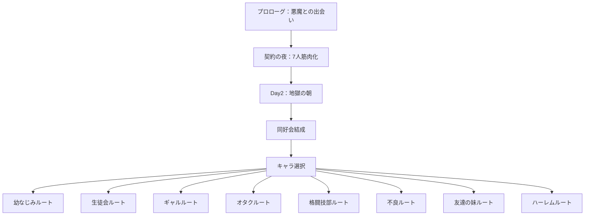
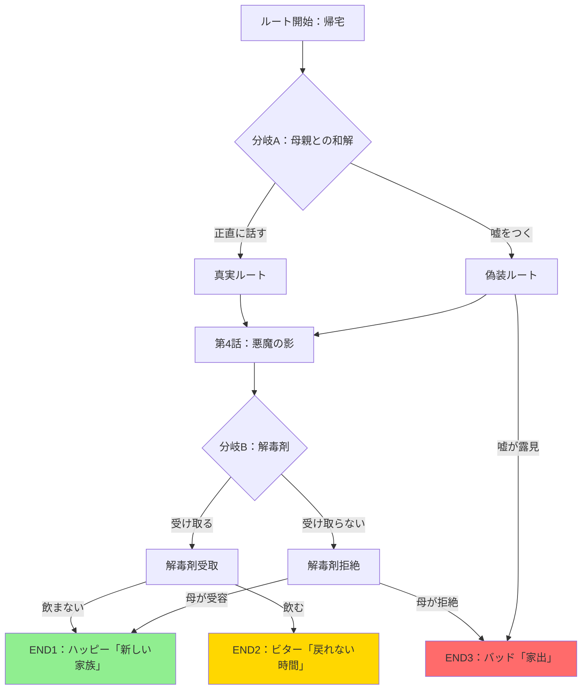
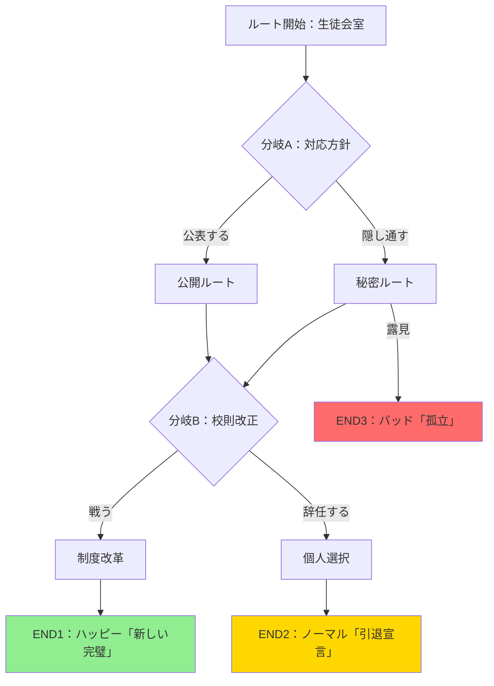
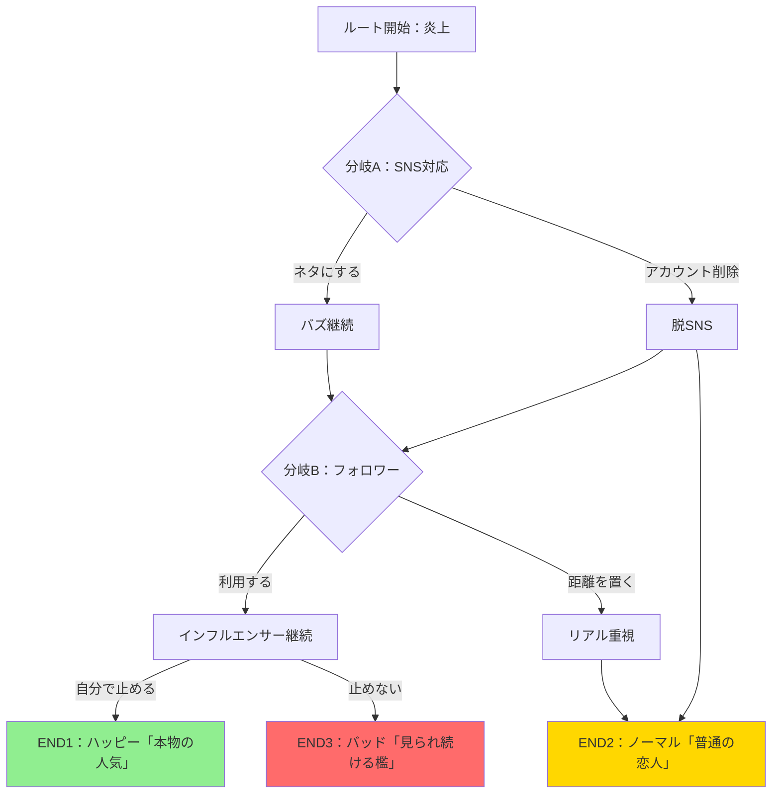
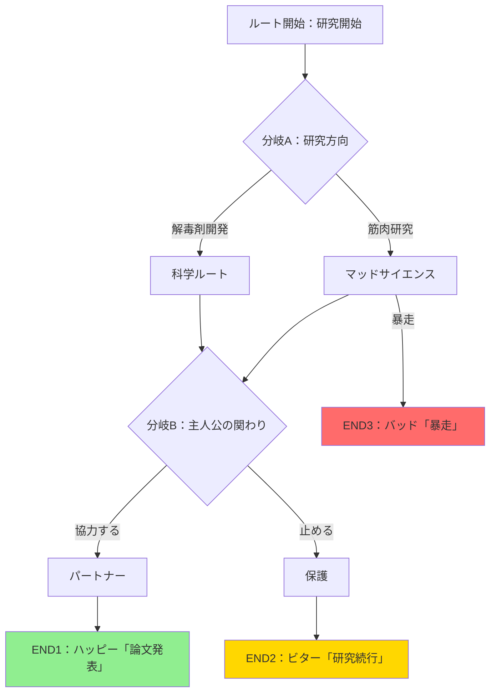
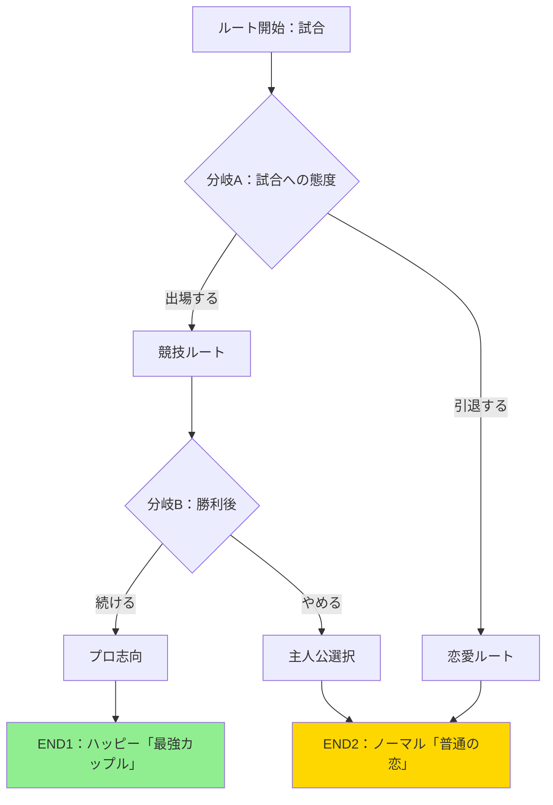
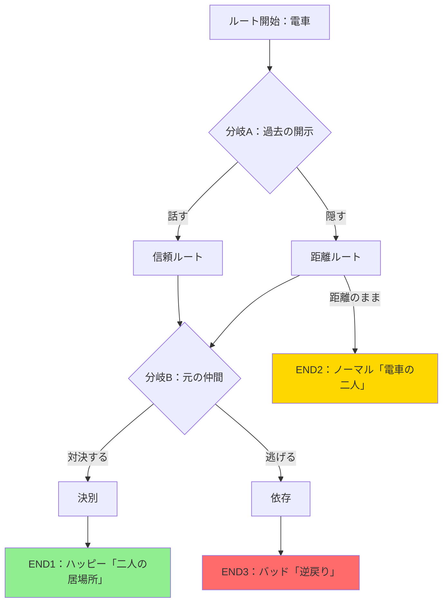
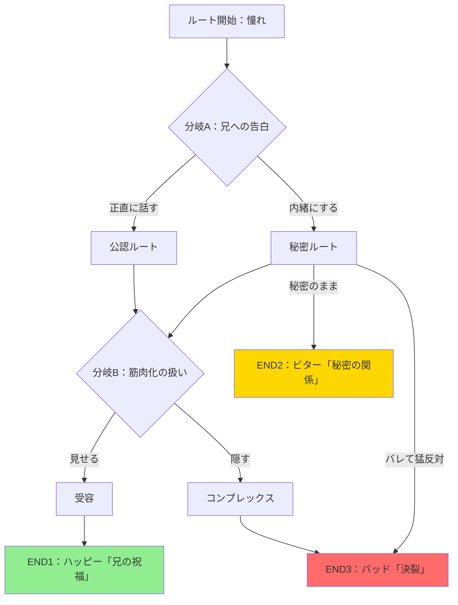
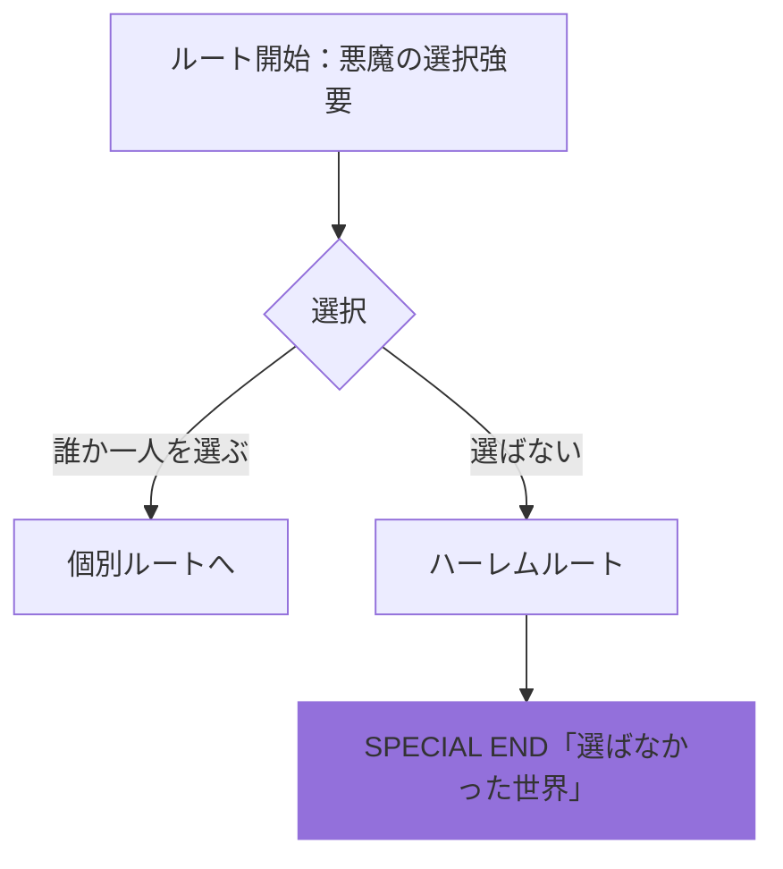

# 全ルートフローチャート

## 📊 全体構造

---

## 🌸 幼なじみルート「帰れない家」

### エンディング条件

| エンディング | 条件 | 悪魔の勝敗 |
|------------|------|----------|
| **ハッピー「新しい家族」** | 真実ルート + 解毒剤拒否 + 母の受容 | ❌ 敗北 |
| **ビター「戻れない時間」** | 解毒剤使用 + 母の受容が元の姿限定 | △ 引き分け |
| **バッド「家出」** | 偽装ルート露見 OR 母の拒絶 + 依存 | ✅ 勝利 |

---

## 👑 生徒会ルート「校則第17条」

### エンディング条件

| エンディング | 条件 | 悪魔の勝敗 |
|------------|------|----------|
| **ハッピー「新しい完璧」** | 公表 + 制度改革成功 | ❌ 敗北 |
| **ノーマル「引退宣言」** | 辞任 + 普通の生徒として | △ 引き分け |
| **バッド「孤立」** | 秘密ルート露見 + 信頼喪失 | ✅ 勝利 |

---

## 💄 ギャルルート「10万いいね」

### エンディング条件

| エンディング | 条件 | 悪魔の勝敗 |
|------------|------|----------|
| **ハッピー「本物の人気」** | バズ継続 + 自分で制御 | ❌ 敗北 |
| **ノーマル「普通の恋人」** | 脱SNS OR 距離を置く | △ 引き分け |
| **バッド「見られ続ける檻」** | 利用 + 止めない → 観測依存 | ✅ 勝利 |

---

## 🔬 オタクルート「被験体」

### エンディング条件

| エンディング | 条件 | 悪魔の勝敗 |
|------------|------|----------|
| **ハッピー「論文発表」** | 解毒剤開発成功 + 協力 | ❌ 敗北 |
| **ビター「研究続行」** | 研究没頭 + 恋愛二の次 | △ 引き分け |
| **バッド「暴走」** | マッドサイエンス + 体調悪化 | ✅ 勝利 |

---

## 🥊 格闘技部ルート「勝ちすぎた代償」

### エンディング条件

| エンディング | 条件 | 悪魔の勝敗 |
|------------|------|----------|
| **ハッピー「最強カップル」** | 競技続行 + 主人公がマネージャー | ❌ 敗北 |
| **ノーマル「普通の恋」** | 引退 + 普通の女の子として | △ 引き分け |

**注**：このルートはバッドENDなし（2END構成）

---

## 🚂 不良ルート「電車の中の君」

### エンディング条件

| エンディング | 条件 | 悪魔の勝敗 |
|------------|------|----------|
| **ハッピー「二人の居場所」** | 信頼 + 決別 + 悪魔を使わない | ❌ 敗北 |
| **ノーマル「電車の二人」** | 距離維持 + ゆっくり接近 | △ 引き分け |
| **バッド「逆戻り」** | 逃げる + 無自覚に悪魔使用 | ✅ 勝利 |

---

## 👧 友達の妹ルート「お兄ちゃんの親友」

### エンディング条件

| エンディング | 条件 | 悪魔の勝敗 |
|------------|------|----------|
| **ハッピー「兄の祝福」** | 公認 + 受容 + 堂々と | ❌ 敗北 |
| **ビター「秘密の関係」** | 秘密維持 + 時限爆弾 | △ 引き分け |
| **バッド「決裂」** | 秘密露見 + 善意による破壊 | ✅ 勝利 |

---

## 💫 ハーレムルート「選ばない」

### エンディング条件

| エンディング | 条件 | 悪魔の勝敗 |
|------------|------|----------|
| **SPECIAL END「選ばなかった世界」** | 全員を彼女候補のまま維持 | ❓ 判定不能 |

**注**：このルートは TRUE END ではなく、各個別ルートと対等な選択肢の一つ

---

## 📈 悪魔の勝率分析

| ルート | ハッピー | ノーマル/ビター | バッド | 悪魔勝率 |
|--------|---------|----------------|--------|---------|
| 幼なじみ | ❌ | △ | ✅ | 33% |
| 生徒会 | ❌ | △ | ✅ | 33% |
| ギャル | ❌ | △ | ✅ | 33% |
| オタク | ❌ | △ | ✅ | 33% |
| 格闘技部 | ❌ | △ | - | 0% |
| 不良 | ❌ | △ | ✅ | 33% |
| 友達の妹 | ❌ | △ | ✅ | 33% |
| ハーレム | - | - | - | ❓ |

### 悪魔の戦略パターン

1. **依存誘導型**（幼なじみ、不良、友達の妹）
   - 「守る」という善意を利用
   - 居場所を失わせて主人公に依存させる

2. **孤立誘導型**（生徒会、ギャル）
   - 社会的立場や承認欲求を利用
   - 「完璧」「人気」への執着を煽る

3. **暴走誘導型**（オタク）
   - 好奇心や探究心を利用
   - 自己実験の過激化を促す

---

## 🎯 制作進捗

| ルート | 進捗 | ファイル数 | 状態 |
|--------|------|-----------|------|
| 幼なじみ | 100% | 9/9 | ✅ 完成 |
| 生徒会 | 0% | 0/9 | ⬜ 未着手 |
| ギャル | 11% | 1/9 | 🚧 作業中 |
| オタク | 0% | 0/9 | ⬜ 未着手 |
| 格闘技部 | 0% | 0/7 | ⬜ 未着手 |
| 不良 | 0% | 0/9 | ⬜ 未着手 |
| 友達の妹 | 0% | 0/9 | ⬜ 未着手 |
| ハーレム | 100% | 1/1 | ✅ 完成 |

**総進捗：** 11/63ファイル（約17%）

---

## 📝 次のステップ

### Phase 1（システム確立）- 進行中
- ✅ 幼なじみルート完成
- ⬜ 生徒会ルート作成

### Phase 2（本命）
- ⬜ 不良ルート
- ⬜ 友達の妹ルート

### Phase 3（バリエーション）
- 🚧 ギャルルート（作業中）
- ⬜ オタクルート
- ⬜ 格闘技部ルート

### Phase 4（統合）
- ✅ ハーレムルート完成
- ⬜ 全ルート統合テスト
